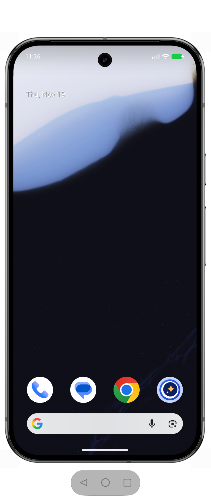
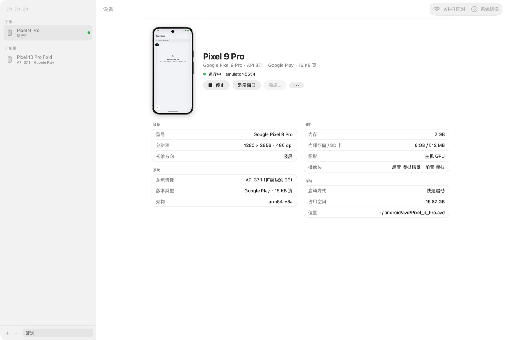
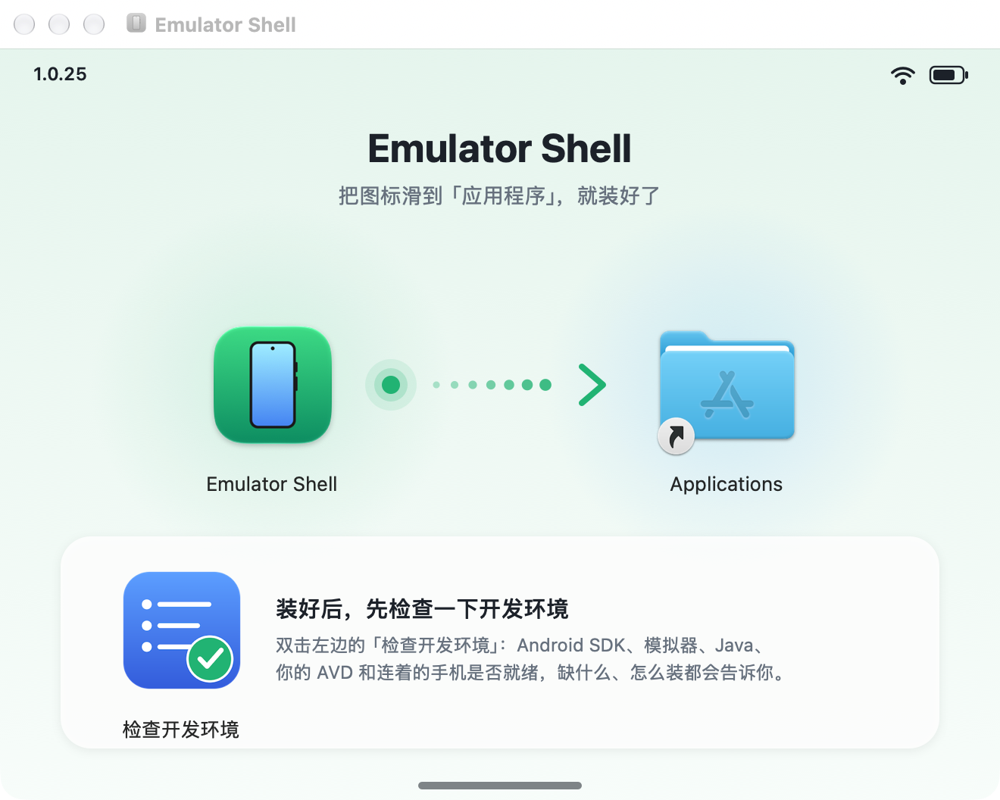

# Emulator Shell

[English](README.md) | 简体中文

一个 macOS 原型：自己绘制 Android 模拟器的设备外框，而不使用模拟器自带的窗口。模拟器以无窗口方式运行（`-no-window -gpu host -grpc <port>`）；本 App 通过模拟器的 gRPC API 拉取画面，并用 Core Animation 把它合成在皮肤图片之下，因此外框边缘和屏幕圆角在桌面上都是抗锯齿的。

Windows 版位于 `windows/`（WinUI 3 和 C#），见下文 [Windows](#windows)。本文其余部分介绍 macOS 版，Windows 版在功能上与之一一对应。

<table>
  <tr>
    <td align="center" valign="bottom"></td>
    <td align="center" valign="bottom"></td>
  </tr>
  <tr>
    <td align="center">设备窗口</td>
    <td align="center">设备管理器</td>
  </tr>
</table>

## 运行

```bash
swift build
.build/debug/EmulatorShell
```

不带参数时打开设备管理器：左侧先是通过 USB 或 Wi-Fi 连接的手机和平板，然后是按类别分组的 AVD，右侧是所选设备的详情（见“物理设备”一节）。在这里可以启动、停止、新建、编辑、复制、清除数据和删除 AVD，以及下载或移除系统镜像。`EmulatorShell <avd> [emulator arguments]` 直接打开该设备，不经过管理器，窗口关闭时退出。

`scripts/make-app.sh` 构建 release 版本并安装为 `~/Applications/Emulator Shell.app`（也可以用参数指定其他文件夹），这样就能从启动台、聚焦搜索或程序坞打开管理器。修改代码后需重新运行。Bundle identifier 是 `EmulatorShell`，与直接运行可执行文件时的 defaults 域相同，因此无论以哪种方式启动，窗口大小和设置都是同一份。

`scripts/make-dmg.sh` 构建供其他 Mac 使用的安装包 `dist/EmulatorShell-<version>-<arch>.dmg`（约 12 MB，版本号与 Windows 一样为 1.0.<提交数>）。磁盘映像文件、其卷和窗口都带有 App 的图标。窗口画成一块横屏的 Android 屏幕（`scripts/make-dmg-art.swift`）：带版本号的状态栏、从 App 滑向“应用程序”的手势，以及一张“检查开发环境”卡片（`scripts/dmg/检查开发环境.command`）。该卡片在终端中打开，按 `Sdk.swift` 查找的方式检查 App 所需的一切：SDK、emulator、adb、cmdline-tools、Java、AVD（标出面向其他处理器的 AVD）、已连接的手机以及是否安装了 SDK 转发器，并给出每项的修复方法，最后询问是否打开 App。窗口布局由访达完成，所以第一次运行时会请求允许终端控制访达。App 只做了 ad hoc 签名、未经公证，因此在别的 Mac 上第一次需要右键 › 打开。

<p align="center"></p>

退出（⌘Q）或关闭设备窗口（⌘W）时，会以与关闭模拟器自带窗口相同的方式关闭模拟器，包括保存快速启动快照。窗口立即消失；App 在后台等所有模拟器都保存完快照后才真正退出（手机约 10 秒）。可以同时运行多台设备，每台从 8554 起依次分配下一个空闲的 gRPC 端口。模拟器的输出写入 `$TMPDIR/emulator-shell-<avd>.log`；App 自身的错误还会写入 `~/Library/Logs/EmulatorShell.log`（不超过 1 MB，上一份保存为 `EmulatorShell.old.log`）。设置 `EMULATOR_SHELL_DEBUG=1` 会记录触摸、按键、折叠屏姿态、帧尺寸或上报的旋转方向的变化，并每 5 秒记录一次帧率，包括模拟器跳过的帧（`seq` 中的空缺）、因所有显示 surface 仍在屏幕上而丢弃的帧，以及相对模拟器帧时间戳的延迟。设置 `EMULATOR_SHELL_GRPC_FRAMES=1` 则改为在 gRPC 消息中传输像素而不用共享内存，用于对比。

SwiftPM 通过 clang 并以 `--sysroot` 链接，而 clang 不会从中读取 SDK 版本，于是二进制会把部署目标（15.0）记作其 SDK，AppKit 就会把 App 画成 macOS 15 的样子（旧的窗口按钮、控件和工具栏）。因此 `Package.swift` 还会把当前所选 Xcode 的 SDK 以 `-isysroot` 传给链接器；`otool -l .build/debug/EmulatorShell | grep -A4 LC_BUILD_VERSION` 可以查看二进制记录的 SDK。

需要位于 `$ANDROID_HOME`（或 `~/Library/Android/sdk`）且带命令行工具的 Android SDK；`avdmanager` 和 `sdkmanager` 需要 Java（`$JAVA_HOME`、Android Studio 自带的运行时或 Homebrew 的 OpenJDK）；代码生成需要 `PATH` 上的 `protoc`（`brew install protobuf`，或设置 `$PROTOC_PATH`）。

## 在 Android Studio、Flutter 和命令行中使用

Android Studio、Flutter 和 `android` CLI 都运行 SDK 中的 `emulator/emulator`，且没有改用其他程序的设置。**Emulator Shell › 让 Android Studio 等工具使用 Emulator Shell** 会把该文件替换为一个转发脚本，并把原文件保留在旁边，名为 `emulator.real`：

- 启动设备（`-avd X` 或 `@X`）时，在同一进程中运行 `EmulatorShell X <other arguments>`，这样监视模拟器进程的启动方（Studio 就是如此）会在设备窗口关闭时看到进程结束。本 App 自己设置的参数（`-no-window`、`-grpc`、`-gpu`）以及 Studio 工具窗口相关的参数（`-qt-hide-window`、`-grpc-use-token`、`-idle-grpc-timeout`）会被去掉；其余参数（`-netdelay`、`-no-snapshot-load`、`-wipe-data`……）传给模拟器。
- 其他调用都原样交给 `emulator.real`：`-list-avds`、`-version`、`-accel-check`、Gradle Managed Devices 之类的 `-no-window` 无窗口运行，以及本 App 自己启动的模拟器（它们带有 `EMULATOR_SHELL_PASSTHROUGH=1`）。
- 调用记录在 `~/Library/Logs/EmulatorShell-forwarder.log`。

在 Android Studio 中还要关闭 Settings › Tools › Emulator › "Launch in the Running Devices tool window"。关闭该菜单项会把 `emulator.real` 移回原处。SDK 更新安装新版 emulator 时会覆盖转发器；管理器打开时会发现这一点并提示重新安装（届时新的二进制会成为 `emulator.real`）。

**Emulator Shell › 安装命令行工具 emulator-shell** 会把 `emulator-shell` 链接到 `/opt/homebrew/bin`（或 `/usr/local/bin`、`~/.local/bin`）：`emulator-shell <avd> [emulator arguments]` 打开设备，单独运行 `emulator-shell` 打开管理器。

## 设备管理器

| 操作 | 实现 |
|---|---|
| 列出 AVD | `~/.android/avd/*.ini` 及各 AVD 的 `config.ini`；App 每次变为活跃时重新读取 |
| 运行状态 | 本 App 的会话，加上模拟器写入 `~/Library/Caches/TemporaryItems/avd/running` 的 `pid_*.ini` 文件，因此在别处启动的模拟器也会显示 |
| 显示在别处启动的设备 | **在本 App 中显示** 把设备窗口连接到其 `pid_*.ini` 中的 `grpc.port`（若 Studio 设置了 `grpc.token`，则将其作为 bearer token；不支持使用 `-grpc-use-jwt` 的模拟器）。关闭该窗口只会断开设备；**停止** 用 SIGINT 将其关闭。声音仍由启动它的程序播放。对已在别处运行的设备执行 `EmulatorShell <avd>` 效果相同 |
| 切换到启动它的 App | 在模拟器进程及其祖先进程中找到最近的一个普通 App（Android Studio、终端、模拟器自带的窗口）并激活；如果是另一个 Emulator Shell，还会通过分布式通知请它把该设备的窗口调到前面 |
| 启动 / 冷启动 | `emulator -avd <id> -no-window -gpu host -grpc <port>`（冷启动加 `-no-snapshot-load`） |
| 新建 | `avdmanager create avd -n <id> -k <image> -d <device> -c <sd>M`，然后把表单中的值写入 `config.ini` |
| 编辑 | 只改 `config.ini`；设备类型和 SD 卡大小在创建后不可更改 |
| 清除数据 | 删除 `userdata-qemu.img*`、`cache.img*` 和 `snapshots/` |
| 删除 | `avdmanager delete avd -n <id>` |
| 设备类型 | `avdmanager list device`，按标签和名称分组；不包括 XR 和眼镜类配置 |
| 系统镜像 | `system-images/` 下的每个 ABI 文件夹；面板只列出适用于本机处理器的镜像（Apple 芯片上为 arm64，Intel 上为 x86），除非打开“显示全部平台的镜像”，此时会多出一列“平台”；新建设备时也只提供这些镜像。没有 `source.properties` 的文件夹表示安装中断。可下载的镜像来自 `sdkmanager --list`，缓存在 `~/Library/Caches/EmulatorShell/sdkmanager-list.txt`，打开镜像面板时刷新。下载和移除使用 `sdkmanager --install` / `--uninstall`。 |

## 输入

- 在屏幕上点击 / 拖动：单指触摸。
- 在外框、标题栏或按钮条上任意位置拖动：移动窗口。拖动使窗口顶部抵到屏幕顶部后，标题栏会显示出来，因为此时指针已无法到达设备上方那条用来唤出标题栏的区域；松开后标题栏隐藏，除非指针正位于该区域内。
- 键盘输入：可打印 ASCII 字符、Enter、Tab、Backspace、Delete、方向键、Home/End、Page Up/Down。
- Esc 或 ⌘B：返回。⇧⌘H：主屏幕。⇧⌘O：概览。⌘L：电源。⌥⌘↑ / ⌥⌘↓：音量。⌘S：截图保存到桌面。⌘← / ⌘→：旋转。⇧⌘F：折叠或展开折叠屏。
- 折叠屏设备的右侧有一条始终显示的姿态栏，列出其姿态：展开、合上和半开，并标出当前姿态。其他设备没有这条栏。
- 外框上画出的电源键和音量键可以点击；按住即相当于按住该键。
- 右键：以菜单形式提供同样的设备命令。

## 窗口大小

设备窗口是一个无边框窗口，容纳设备本身、设备上方留给标题栏的空间（标题栏隐藏时也保留）、下方的按钮条，以及折叠屏两侧留给姿态栏的空间（姿态栏在右侧；左侧留出同样宽度，使设备居中），因此窗口大小就是它显示的全部内容。这些栏不随缩放变化，宽度与设备相同：设备较窄时，标题栏依次省略设备名称、音量和电源按钮（外框上和“设备”菜单中也有），然后是旋转和截图按钮；前端的窗口按钮和“更多”始终保留。这些窗口按钮是系统的关闭（同 ⌘W）、最小化（⌘M）和缩放按钮；缩放按钮是灰色的，因为设备窗口没有全屏，其各种尺寸在“窗口”菜单中。窗口周围有 8 pt 的透明边距，容纳角落调整大小区域的外侧部分。

- 拖动设备的一角：保持比例，窗口的对角保持不动，尺寸计入各栏，整个窗口保持在屏幕可见区域内。尺寸按指针沿设备对角线方向移动的距离增长，因此从当前大小朝任何方向拖动都能平滑变化。和标准窗口的角一样，每个区域向外伸出设备矩形 8 pt，向内伸到机身圆角稍内侧（按皮肤图片测得），因此正好落在肉眼看到的角上。指针恰好在这些区域上方时显示调整大小光标（前提是 App 处于活跃状态，没有 App 能在后台更改光标），在此处按下总是调整大小，而不会点到后面的窗口。标题栏的位置会显示当前尺寸，例如“80% · 1030 × 2298”（相对于一个设备像素对应一个屏幕像素，以及以屏幕像素计的显示尺寸）。拖动时会吸附到下面列出的尺寸。拖动过程中只拉伸已绘制的图层；松开后按新尺寸重新绘制皮肤，并以新的像素尺寸请求帧。
- “窗口”菜单：像素一比一 ⌘1（一个设备像素对应一个屏幕像素）、物理尺寸 ⌘2（真机的大小，由 `hw.lcd.density` 和屏幕的毫米尺寸算出）、适合屏幕 ⌘3、放大 ⌘+ / 缩小 ⌘−（每步为一比一尺寸的 10 %）。每次缩放都会在 0.3 秒内缓动地放大或缩小设备：与折叠动画一样，在设备窗口上方的一个透明窗口中播放一张静止画面（`ZoomAnimation`）。这是因为窗口 frame 的每一步变化与按其大小绘制的设备会相隔一帧才到达屏幕，导致设备全程抖动几个点。窗口在下面以相同时长调整大小，各条边分别缓动并取整，使顶部保持不动；结束时按新尺寸重新绘制设备并显示实时画面。半开状态下，平面的静止画面无法表现，因此改为把设备拉伸到窗口的每一步大小。
- 限制：设备长边至少 360 pt，整个窗口不超出屏幕可见区域。拖到部分超出屏幕的窗口在松开后会移回。
- 旋转时，转动动画持续 0.3 秒，窗口随之以相同缓动调整大小；如果旋转后的设备需要以另一尺寸显示才能放下，这一变化也会一起做动画。
- 旋转保持尺寸不变。如果旋转后的设备放不下，就先缩小显示，直到能以所选尺寸放下为止；把窗口移到较小的屏幕上时也是如此。
- 尺寸、方向和位置按 AVD 分别记住（App defaults 中的 `deviceWindow.<avd>`）。

## “更多”面板

设备标题栏中的 ⋯ 按钮打开一个模拟器功能面板，全部通过 gRPC 实现：

| 图块 | 作用 | 调用 |
|---|---|---|
| 位置 | 经纬度或预设城市 | `setGps` / `getGps` |
| 电池 | 电量和充电器（无、交流电、USB、无线） | `setBattery` / `getBattery` |
| 剪贴板同步 | 开启或关闭双向剪贴板同步 | `streamClipboard` / `setClipboard` |
| 来电与短信 | 来电、远端接听、挂断、保持；接收短信 | `sendPhone` / `sendSms` |
| 指纹 | 手指 1 在传感器上轻触一次 | `sendFingerprint` |
| 麦克风 | 把 Mac 的麦克风接入设备，并以模拟器自身的音频重启设备（见“声音”一节） | `-audio coreaudio -allow-host-audio` |
| 亮度 | 屏幕背光 | `setBrightness` / `getBrightness` |
| 快照 | 列出、保存、恢复和删除快照 | `SnapshotService` |
| 折叠姿态 | AVD 的 `hw.sensor.posture_list` 中的姿态（合上、半开、展开、翻转、帐篷）；仅限折叠屏（`hw.sensor.hinge=yes`） | `setPosture` |

不提供模拟器自带的扩展控制窗口：无窗口模拟器没有 Qt 界面，调用 `UiController.showExtendedControls` 会使其崩溃。

点击弹出框外部、按 Esc 或 App 转入后台时，弹出框会自行关闭。

## 渲染方式

皮肤来自 AVD 的 `skin.path`；只有横屏布局的皮肤（Pixel Tablet）按该方向读取，没有皮肤的 AVD 则使用一个按 `hw.lcd.width/height` 确定大小的简单深色圆角边框。折叠屏的皮肤（Pixel Fold、9 Pro Fold、10 Pro Fold）本身没有 `layout`，而是有一个用于展开状态的 `default` 文件夹和一个用于折叠状态的 `closed` 文件夹；新建的 AVD 以顶层文件夹作为 `skin.path`，与 Android Studio 的写法一致。图层从下到上依次为：

1. 实时画面，由模拟器缩放到窗口的 backing 像素尺寸。
2. 皮肤的 `mask` 图片（边框圆角和摄像头挖孔）。
3. 皮肤的外框图片。

在某些皮肤上，显示区域矩形的直角会伸出圆角外框之外；这些像素从 mask 的四角做漫水填充，并同时从画面和叠加层中裁掉，使其保持透明而不会透出来。

## 折叠屏

窗口通过 `streamNotification` 跟随姿态变化，无论姿态是从“更多”面板、模拟器控制台（`adb emu fold`、`posture`）还是快照设置的。合上时显示皮肤的 `closed` 图片和外屏；展开或半开时显示 `default` 图片。两者与两块屏幕一样以不同的像素密度绘制（Pixel 10 Pro Fold 的合上图片高 2495 像素，展开图片高 2266 像素），因此把合上的图片缩放到展开图片的密度：这样合上的设备正好是展开设备的右半边，与真机一致。缩放前先把它裁到设备轮廓：其布局在下方留了 59 像素，否则会比展开皮肤更高，为适应屏幕而显示得更小。

模拟器在展开时会把书本式折叠屏横过来（冷启动时上报旋转方向 3），而合上的设备则不会。真机在折叠时保持在手中原来的方向，所以这里的折叠屏从第一帧起就按其窗口上次的方向摆放（第一次为竖直），折叠时保持旋转：展开和合上朝向相同，⌘← / ⌘→ 都能旋转。在模拟器跟上之前帧上报的旋转方向不予理会，这样窗口就不会来回转动。

无论姿态如何改变，折叠和展开都有动画，只有设备启动时所处的姿态除外。动画在设备窗口上方的透明窗口中播放（折起的那一半会超出窗口边缘），使用两种状态的画面，同时隐藏实时画面：像书合上一样，铰链左边那一半（在 Pixel Fold 系列上其背面就是外屏）带着一定透视朝观看者转过来，翻到右半边上，转过 90° 后露出外屏，外屏正好落在右半边上方，两者的轮廓共用顶边和外侧边。右半边始终不动，就像平放在桌上。转动的一半保持其画面原样，既不变暗也不模糊。每一半分别绘制外框和屏幕，使进入的那块屏幕可以单独亮起。动画在画面交出后 1/15 秒开始，让渲染服务器先接收画面，避免跳过开头。动画在 0.6 秒内像真实铰链一样运动：开始时较紧，最后十分之一由磁铁把两半吸合，并回弹一次；展开时，磁铁先吸住片刻，然后铰链转开，减速停在平展位置。运动被采样成关键帧而不是用缓动曲线，所以能有这样的形状。如果进入的状态需要以另一尺寸显示（在所选尺寸下放不下屏幕），或者其窗口在落点处放不下，就在此期间放大或移动过去。窗口连同标题栏和按钮条在相同时长内以相同缓动调整大小，与折叠同时结束：在屏幕每次刷新时按折叠到达的位置步进（AppKit 的 animator 有自己的时钟，会晚到，在实时画面恢复后再挪动一次窗口），最终停在实时画面随后显示设备时所在的整数点位置。展开时倒放同样的过程。画面在主线程之外绘制，两个动画在画面就绪后同时开始，这样窗口的调整大小（由主线程驱动）就不会被折叠动画（由渲染服务器驱动）拖住。

姿态改变后，另一状态的帧还会持续传来片刻，这些帧永远不会显示在皮肤中；而模拟器刚切换到的屏幕的最初几帧是空白的。因此实时画面在切换时变暗，空白帧永远不会替换已有画面。进入的屏幕在动画中是暗的，就像真机在点亮之前一样（保留该屏幕上次点亮时的一帧，会显示设备当时的内容，然后跳到现在的内容），等 Android 点亮它后再在 0.2 秒内淡入。如果动画在此之前结束，就保持最后一张画面，直到屏幕亮起，或者在什么都没传来时保持 1.5 秒（设备在折叠时进入休眠），这样实时画面就从一块已亮起的屏幕接手。在折叠处展开的设备会准确回到原来的位置。

切换屏幕时，Android 先拉伸绘制旧布局，然后在窗口按新尺寸重绘期间只显示壁纸，最后才是新布局。真机在此期间会保持屏幕关闭（"Blocking screen on until initial contents have been drawn"）；模拟器却照样推送这些帧，也不上报背光变化。所以这里跟踪 guest 的日志（`GuestLogWatch`：`adb logcat -T 1 -e "Unblocked screen on"`，在 guest 中过滤；模拟器的 `streamLogcat` 什么都不发送），进入的屏幕在 Android 点亮它之后、第一个与当时所显示帧不同的帧（在 32 × 32 网格采样中相差 2 %）到来时亮起，或在 0.5 秒后亮起：Android 在窗口报告绘制完成时点亮屏幕，往往比新布局真正传来早一点。如果姿态改变后 1.2 秒内日志没有消息，就由第一个非空白帧点亮。

Android 自身的展开动画（屏幕从铰链处亮起、图标从中间向外移动）在模拟器中不会播放，即使把铰链角度从 0° 缓慢扫到 180° 也是如此：上述各个布局是直接切换的。

半开（“更多”面板中的“折叠姿态”，或 `adb emu posture 2`）显示内屏，铰链左边那一半绕铰链朝观看者转过 30°，景深与折叠动画相同，大致与 Xcode 的 iPhone Duo 显示 "Partially Open" 的样子相仿；右半边保持不动。为此，实时画面把那一半再绘制一次（用自己的显示图层显示相同的帧，外框亦然），每份副本只遮罩出铰链一侧，点击这一半时会经过旋转换算找到触点。在展开和半开之间，那一半在 0.45 秒内转动；从半开折叠时从该角度开始，展开到半开时停在该角度。

折叠屏以一个在所选缩放下两块屏幕都能容纳的尺寸推流，因此折叠时从不需要请求新的流：在模拟器切换屏幕时请求新流曾导致其崩溃（gfxstream 写一帧时越过了共享缓冲区的末尾）。

模拟器按展开屏幕的像素（`hw.lcd.width/height`）读取触摸坐标，再缩放到 guest 显示的屏幕上，所以在合上时，外屏上的点要先放大到该尺寸再发送。

## 帧传输

调用 `streamScreenshot` 时使用 `ImageTransport.MMAP`，并传入指向 `$TMPDIR/emulator-shell-<avd>-<side>.frames` 的 `file://` 句柄（窗口变大需要更多空间时换一个新文件），这样模拟器把 RGBA 像素直接写入该映射文件，每条 gRPC 消息只用来通知有新帧。帧到达后被重排为 BGRA（并强制 alpha 不透明），写入四个 IOSurface 之一，后者直接成为显示图层的内容，无需再次上传。在 M2 上滚动“设置”约为 60 fps，延迟低于 15 ms。

`-gpu host` 与传输方式同样重要：使用 `-no-window` 时，AVD 的 `hw.gpu.mode=auto` 会回退到 SwiftShader，guest 本身只能渲染约 20 fps。切换 GPU 模式会使快速启动快照失效一次，因此切换后的第一次启动是冷启动。改为在 gRPC 消息中传输像素（每帧约 5 MB）跟不上 60 fps 的 guest；流会落后好几秒。

## 声音

模拟器以 `-audio none` 启动，由本 App 播放设备的声音：`streamAudio` 以约 10 ms 一包的方式送来 48 kHz 16 位立体声（包括静音包），由 `AVAudioPlayerNode` 播放，队列最多 100 ms（通常约 30 ms）。音频引擎只在有声音可听时运行，静音 2 秒后停止，因此安静的设备不会让 Mac 保持唤醒。

模拟器自带的 CoreAudio 输出（emulator 37.2.12）可能死锁：启动音频流的 vCPU 线程（`virtio_snd` → `AUD_set_active_out` → `AudioDeviceStart`）持有 qemu 的全局锁和后端的 voice 锁，同时等待 CoreAudio 的播放线程，而后者正在 `ca_out_device_wconv_ioproc` 中等待那把 voice 锁。主循环和所有 vCPU 都会停住，15 秒后模拟器的卡死检测器会杀掉进程。使用 `-audio none` 时，模拟器中没有 CoreAudio 线程参与。用模拟器自带音频保存的快照可以正常加载。

从 Android Studio 或命令行传入的参数如果已经指定了音频（`-audio …`、`-no-audio`），则予以保留，此时本 App 不播放任何声音。

只有模拟器自带的音频能接收 Mac 的麦克风：`-audio none` 给 guest 的是静音，而改用 gRPC 输入（`injectAudio`）会在流打开时立即导致 emulator 37.2.12 崩溃（`audio_forwarder_enable`，空指针），无论运行的是哪个音频后端。所以在“更多”面板中打开“麦克风”会以 `-audio coreaudio -allow-host-audio` 重启设备（会先询问，并提醒这可能触发上述死锁），关闭则以 `-audio none` 重启。该选择按设备记住（App defaults 中的 `microphone.<avd>`）。重启会保存并加载快速启动快照，需要几秒钟。

## 物理设备

管理器侧边栏的第一项是 **物理设备**：adb 能看到的所有非模拟器设备，来自 `adb track-devices -l`，因此设备插入或拔出后一秒内就会出现或消失，无需轮询。使用的是 SDK 自带的 adb（即 Android Studio 使用的那个），因此两者共用同一个 adb server；没有 platform-tools 时，面板会提供用 `sdkmanager` 安装。每台设备获得授权后，其详情（名称、Android 版本、屏幕尺寸和密度、电量、存储）通过一次 `adb shell` 调用取得；名称在厂商设置了 `ro.product.marketname` 时用它，否则用型号。同时通过 USB 和 Wi-Fi 连接的设备只显示一行，使用 USB；两台 USB 设备总是两行，即使它们报告相同的序列号（有些廉价设备就是这样）。

| 状态 | 显示内容 |
|---|---|
| 已授权 | 实时预览（选中时每 2 秒一次 `screencap`，推流期间使用流中的帧）、投屏、截图、录屏，以及一个“⋯”菜单：切换到 Wi-Fi（`adb tcpip 5555` + `adb connect`）、安装 APK 或复制文件、重启、断开 / 忘记 Wi-Fi 设备 |
| 未授权 | 说明如何在设备上允许 USB 调试；允许后变为上面的状态 |
| 离线 | 已配对但不在网络中的 Wi-Fi 设备仍保留在列表中（记在 defaults 的 `pairedDevices` 中），并提供“重新连接”和“忘记此设备” |
| 未连接任何设备 | 一行“连接 Android 设备…”，给出 USB 连接步骤和 Wi-Fi 配对入口 |
| 已断开 | 选中的设备消失（被拔出、被忘记）时，面板中显示“设备已断开”，设备回来后重新显示 |

**Wi-Fi 配对**（⇧⌘N 或工具栏，Android 11+）与 Android Studio 的方式相同：显示一个二维码 `WIFI:T:ADB;S:<name>;P:<password>;;`，设备在“无线调试”中扫描后，会通过 mDNS 提供该配对服务，再由 `adb pair` 完成配对；或者对用 `adb mdns services` 找到的配对服务输入设备上的六位配对码。之后 adb 会自动连接已配对的设备。

**投屏** 在设备上运行 scrcpy-server 5.0.1（`vendor/scrcpy`，Apache 2.0）：将其推送到 `/data/local/tmp`（每次都推，因为它启动时会删除自身），用 `app_process` 启动；一个 `adb forward` 承载视频 socket（来自设备编码器的 H.264，用 VideoToolbox 解码为基于 IOSurface 的帧）、音频 socket（原始 48 kHz 16 位立体声，Android 11+，播放方式与模拟器的声音相同）和控制 socket（`Scrcpy.swift`）。设备得到与模拟器同样的窗口：围绕 adb 报告尺寸的屏幕的简单边框、“窗口”菜单中的各种尺寸（物理尺寸取自 `dumpsys display` 中面板的真实 dpi）、拖角调整大小以及记住的位置。窗口跟随设备自身的旋转：视频尺寸变化表示设备转动了，`dumpsys input` 给出朝向；旋转按钮不显示。关闭窗口只会停止投屏。

- 输入：点击或拖动为单指；⌥-拖动会增加一根以中心为对称点的手指（双指缩放）；滚动即滚动；按键与模拟器相同，ASCII 文本作为按键输入，其他内容（中文、emoji）通过设备剪贴板粘贴；⌘V 粘贴 Mac 的剪贴板；把 APK 拖放到设备上即安装，其他文件放到 `/sdcard/Download`。
- MIUI 和 HyperOS 在开发者选项中打开“USB 调试（安全设置）”（`persist.security.adbinput`）之前拒绝来自 adb 的输入；详情面板会说明这一点，窗口会在第一次触摸时提醒。HyperOS 2 不设置该属性，所以 server 日志中出现注入事件被拒绝（`INJECT_EVENTS`）的记录时也会标记该设备，直到下次推流开始。屏幕画面照常推送。
- One UI（一台 Android 12 的 Galaxy S10+）在设置视频编码器时会以 "stack corruption detected" 中止 server，前提是 server 的命令行达到 265 字节：其媒体框架会把这行读入一个固定大小的缓冲区。所以启动 server 时只传与默认值不同的选项，最多 226 字节。运行时在杀掉 server 时打印的内容会作为推流结束的原因显示，而不是“控制通道断开”。
- 窗口的“更多”弹出框：声音在 Mac 上还是在设备上播放、投屏时关闭设备自身的屏幕、保持唤醒、剪贴板同步、显示触摸点、画质（长边 1280 / 1920 / 原始，码率 4 / 8 / 16 Mbit/s）以及发送文件。除屏幕外的选项都是 scrcpy 的启动选项，因此更改后会重连推流；这些选项按设备记住（`mirror.<id>`）。
- 窗口打开期间推流结束（被拔出、Wi-Fi 断开、server 被杀）时，设备上会覆盖一条消息；设备回来后会自动重新开始，无论通过哪种连接。

**截图**（⌘S，在窗口中，或针对管理器中选中的设备）是按屏幕分辨率的 `screencap` PNG，以 `<name>_<date>.png` 保存在桌面；会在输出中搜索 PNG 数据，因为折叠屏会先打印一条关于其屏幕的警告。全黑的截图（带 `FLAG_SECURE` 的 App）不保存。

**录屏**（⇧⌘R，同样如此）不需要窗口：如果没有推流在运行就会打开推流。解码后的帧用 AVAssetWriter 重新编码为 H.264，尺寸取第一帧的大小；设备转动后，帧会加黑边适配到该尺寸，因为一条 MP4 轨道不能改变尺寸。设备发送声音时会加入声音。文件以 `<name>_<date>.mp4` 保存到桌面，在设备消失或 App 退出时会正确收尾。录制期间，侧边栏的那一行和详情面板会显示时长，窗口则在设备上方显示。

`EMULATOR_SHELL_MIRROR_EMULATORS=1` 会把运行中的模拟器也列在物理设备中（scrcpy 支持模拟器），便于在没有手机时试用这些功能。

## 尚未完成

- 模拟器不支持滚轮和多点触控（物理设备两者都支持）。
- 录屏只支持物理设备；模拟器只有截图。
- 折叠屏同一时间只显示展开或合上时的屏幕，不能同时显示两块（Pixel Fold 的后屏模式），半开姿态按展开绘制。

## Windows

`windows/` 中是同一个 App 的 Windows 版，支持 Windows 10（19041）及更高版本：WinUI 3（Windows App SDK 1.8，随 App 打包）、.NET 10 上的 C#，通过 `Grpc.Net.Client` 使用同一套 proto（`windows/Protos`）调用模拟器的 gRPC API，并用 Visual 层和 Win2D 绘制设备。设备窗口、设备管理器、“更多”面板、折叠屏和 SDK 转发器都如上文所述，区别如下。

### 构建与运行

需要 .NET 10 SDK（`winget install Microsoft.DotNet.SDK.10`），以及位于 `%ANDROID_HOME%`（或 `%LOCALAPPDATA%\Android\Sdk`）且带命令行工具的 Android SDK。`JAVA_HOME` 未设置或低于 17 时，`avdmanager` 和 `sdkmanager` 使用 Android Studio 自带的 Java 运行。

```bash
dotnet build windows/EmulatorShell -p:Platform=x64
```

`windows/EmulatorShell/bin/x64/Debug/net10.0-windows10.0.22621.0/win-x64/EmulatorShell.exe [avd [emulator arguments]]` 打开管理器或设备，与 macOS 相同。`powershell -ExecutionPolicy Bypass -File windows\build.ps1` 构建 release 版本并安装到 `%LOCALAPPDATA%\Programs\Emulator Shell`，同时创建开始菜单快捷方式。

`powershell -ExecutionPolicy Bypass -File windows\package.ps1` 用 WiX 5（`dotnet tool install --global wix --version 5.0.2`）从 `windows\installer\EmulatorShell.wxs` 构建供其他电脑使用的安装包 `windows\dist\EmulatorShell-<version>-x64.msi`（约 73 MB）。App 和转发器以自包含方式发布，所以电脑上既不需要 .NET 也不需要 Windows App SDK。MSI 按用户安装，无需管理员权限，安装到 `%LOCALAPPDATA%\Programs\Emulator Shell` 并创建开始菜单快捷方式，可在“设置 › 应用”中卸载；更新的版本或同一版本的重新构建会替换已安装的版本。版本号为 `1.0.<number of commits>`，除非用 `-Version` 另行指定。发布需要在项目中设置 `EnableMsixTooling`：否则 `dotnet publish` 会漏掉 App 的 `.pri`，管理器会找不到控件的样式。

`windows\scripts\make-icon.ps1` 重新绘制 `Assets\AppIcon.ico` 和 `AppIcon.png`。

### 与 macOS 的区别

- **帧** 通过 gRPC 消息传输。Windows 版模拟器的共享内存传输（`ImageTransport.MMAP`）根本不发送任何帧，无论用哪种句柄（`file:///…`、路径、命名映射）。在 localhost 上通过 gRPC 传输，约 800 × 1800 像素的画面可达 40–60 fps。
- **关闭** 使用 gRPC `setVmState(SHUTDOWN)`，与关闭模拟器窗口一样会保存快速启动快照。控制台的 Ctrl+C 会到达 `emulator.exe`，而在 Windows 上它只是一个启动器，以子进程运行 `qemu-system-x86_64-headless.exe`；启动器退出会在保存中途把模拟器一起带走。与 macOS 一样，模拟器以 `ANDROID_EMULATOR_WAIT_TIME_BEFORE_KILL=90` 启动，因此保存到第 20 秒时不会被杀掉。在别处启动的模拟器通过其 gRPC 端口停止（带上其 `grpc.token`），没有端口时用 `adb emu kill`。
- **声音** 仍由模拟器播放：迫使 macOS 版自己播放声音的死锁位于模拟器的 CoreAudio 后端，而 Windows 版模拟器不使用该后端。所以没有 `-audio none`，“麦克风”通过 `setMicrophoneState` 立即切换主机麦克风，无需重启设备。
- **在别处启动的设备**：“在本 App 中显示”和 `EmulatorShell <avd>` 的连接方式与 macOS 相同（bearer token 取自 `grpc.token`；不支持 `-grpc-use-jwt` 的模拟器）。启动设备的程序是模拟器进程及其祖先进程中最近的一个拥有自己窗口的进程；“切换到”会把该窗口调到前面。另一个 Emulator Shell 则通过命名管道 `EmulatorShell.<pid>`（每个实例都在监听）请它把设备窗口调到前面。
- **窗口** 无边框且透明（透明系统背景，并把 DWM 边框扩展到其上）。其窗口区域只接收设备、设备角落和各栏上的点击；其他位置的点击会到达后面的窗口，与 macOS 相同。设备转动、折叠、半开、调整大小或切换到某个窗口尺寸期间，窗口会改为覆盖设备移动经过的整个区域，只移动内容，并与各栏在同一帧绘制；因此折叠动画直接在设备窗口中播放，而不是在其上方的窗口中，窗口尺寸的放大缩小作用于实时设备画面（先拉伸，结束时重新绘制），而不是一张静止画面。窗口位置和尺寸以屏幕像素计，按显示器分别缩放。
- **键盘**：macOS 菜单快捷键中的 ⌘ 换成 Ctrl：Ctrl+B 返回、Ctrl+Shift+H 主屏幕、Ctrl+Shift+O 概览、Ctrl+L 电源、Ctrl+Alt+↑/↓ 音量、Ctrl+S 截图、Ctrl+←/→ 旋转、Ctrl+Shift+F 折叠、Ctrl+1/2/3 尺寸、Ctrl+=/Ctrl+− 缩放、Ctrl+W 关闭、Ctrl+M 最小化、Ctrl+Shift+2 管理器、Ctrl+Q 退出。窗口的最小化和关闭按钮位于标题栏末端。
- **菜单**：没有菜单栏。其菜单放在设备标题栏前端的菜单按钮（≡）中，在设备上右键也能打开：模拟器管理器、“设备”和“窗口大小”子菜单、转发器和命令行工具、最小化、关闭和退出。管理器的 ⋯ 按钮中有转发器、命令行工具和退出。
- **通知区域和跳转列表**：点击通知区域中的 App 图标会打开管理器；其菜单列出每个 AVD 及其状态（选择一个即显示、启动或连接它），并可退出。右键任务栏按钮会列出“模拟器管理器”和每个 AVD。SDK 转发器启动的每台设备都运行在单独的实例中，因此由第一个拿到命名互斥量（`EmulatorShell.Primary.<hash of the app folder>`）的实例显示图标并维护跳转列表；它退出时由下一个实例接手。不带 AVD 的启动（开始菜单、跳转列表、`emulator-shell`）会通过命名管道请该实例显示其管理器，而不是再打开一个。
- **拖动** 外框或某个栏时，窗口每一帧都跟随指针移动。系统的移动循环（在标题区域发送 `WM_NCLBUTTONDOWN`）从 XAML 的按下事件启动时，移动量与指针的移动毫无关系。
- **物理设备** 与 macOS 相同（见“物理设备”一节），Windows 特有的部分如下：
  - 设备列表从管理器（或其他显示手机的界面）打开时开始跟踪 `adb track-devices`：为单个模拟器打开的 App 实例不运行自己的跟踪器。Windows 上的 adb 写的是 "\r\n"，而每条报告的长度只计算 "\n"，因此在拆分报告前先去掉 "\r"；如果某条报告仍不以长度开头，就启动一个新的跟踪器。
  - 物理设备 分区只在列表中有设备时显示；配对入口在工具栏中。没有 platform-tools 时，只显示一行，提供安装。
  - H.264 流通过 Vortice.MediaFoundation（MIT）用 Windows 的 Media Foundation H.264 解码器以低延迟模式解码；其 NV12 帧在这里按行并行转换为 BGRA，按流中的指示使用 BT.601 或 BT.709，然后像模拟器的帧一样显示。声音通过 WASAPI（NAudio，MIT）播放。
  - 录屏用 Media Foundation 的 sink writer 写成 MP4（H.264 和 AAC），使用 Windows 的软件 H.264 编码器：NVIDIA 的硬件编码器 MFT 会在录制几帧后让整个进程退出。writer 在录制器自己的线程上、在多线程单元（MTA）中创建和使用。
  - 按键：Alt-拖动为双指缩放，滚轮滚动，Ctrl+V 把 Windows 剪贴板粘贴到设备上，Ctrl+Shift+R 录屏（在窗口中，或针对管理器中选中的手机），Ctrl+S 同样可以截图，Ctrl+Shift+V 弹出输入框，把文本放到设备的剪贴板上，Ctrl+Shift+N 打开 Wi-Fi 配对；其二维码用 QRCoder（MIT）绘制。通过设备剪贴板输入的文本（中文、emoji）不会复制回 Windows 剪贴板。
  - 截图和录屏保存到桌面，与 macOS 相同；`scrcpy-server` 及其许可证会复制到 App 旁边（并打包进安装包）。
- **文件**：设置在 `%LOCALAPPDATA%\EmulatorShell\settings.json`；模拟器输出在 `%LOCALAPPDATA%\EmulatorShell\Logs\emulator-<avd>.log`；通过 `%TEMP%\avd\running\pid_*.ini` 查找运行中的模拟器。列出的系统镜像是适用于本机处理器的镜像（x86 镜像，或 ARM 上的 arm64 镜像）；“显示全部平台的镜像”会列出所有镜像，与 macOS 相同。面向其他处理器的 AVD 会被拒绝并说明原因；模拟器在启动完成前退出时会弹出提示，显示其日志中的最后一条错误；选择其他镜像时也会写入 `hw.cpu.arch`。
- **SDK 转发器**：`emulator.exe` 不能是脚本，所以转发器是一个小程序（`windows/Forwarder`，在 App 旁边构建为 `EmulatorShellForwarder.exe`）。开启时把它复制到 `emulator\emulator.exe` 上，原文件保留为 `emulator.real.exe`，并把 App 的路径写入 `emulator\emulator-shell.ini`。它会等待所启动的程序结束并返回其退出码。调用记录在 `%LOCALAPPDATA%\EmulatorShell\Logs\forwarder.log`。
- **命令行工具**：`%LOCALAPPDATA%\Microsoft\WindowsApps` 中的 `emulator-shell.cmd`，该目录在 PATH 上。
- **退出**：管理器和所有设备窗口都关闭后 App 退出；在此之前模拟器先在后台保存完快照。
- **错误** 也会写入 `%LOCALAPPDATA%\EmulatorShell\Logs\emulator-shell.log`。UI 线程上的意外错误会连同调用栈记录在这里，App 继续运行，而不是退出并带走设备窗口和录屏。

Debug 构建会读取 `EMULATOR_SHELL_TEST_SCRIPT`（设备窗口）和 `EMULATOR_SHELL_MANAGER_SCRIPT`（管理器）：以 `;` 分隔的命令，如 `rotate right`、`fold`、`resize 2 200 300`、`more`、`new`、`images`、`mirror device:<serial>`、`record device:<serial>`、`pairing`、`theme dark` 或 `fail`，用于在不操作鼠标的情况下检查窗口（见 `DeviceSession.Debug.cs` 和 `ManagerWindow.Debug.cs`）；管理器的 `shot <name>` 还会把窗口当前的绘制结果保存到 `%TEMP%\<name>.png`。设置 `EMULATOR_SHELL_MIRROR_EMULATORS=1` 后，运行中的模拟器会列在物理设备中，与 macOS 相同。

已知问题，都出在 Windows 版模拟器（36.3.10）上，冷启动（管理器的 ⋯ 菜单）即可恢复：

- 在启动或恢复后几秒内保存的快速启动快照，恢复时曾出现冻结（屏幕停在最后一张画面且不响应输入；VM 报告正在运行）。较长会话后保存的快照可以正常恢复。
- 从快照恢复的折叠屏会丢失外屏：合上时，模拟器记录 `Display with id: 6 does not exist` 且不推送任何画面，因此合上的设备一直是黑的。冷启动后即可如上文所述正常折叠和展开。
